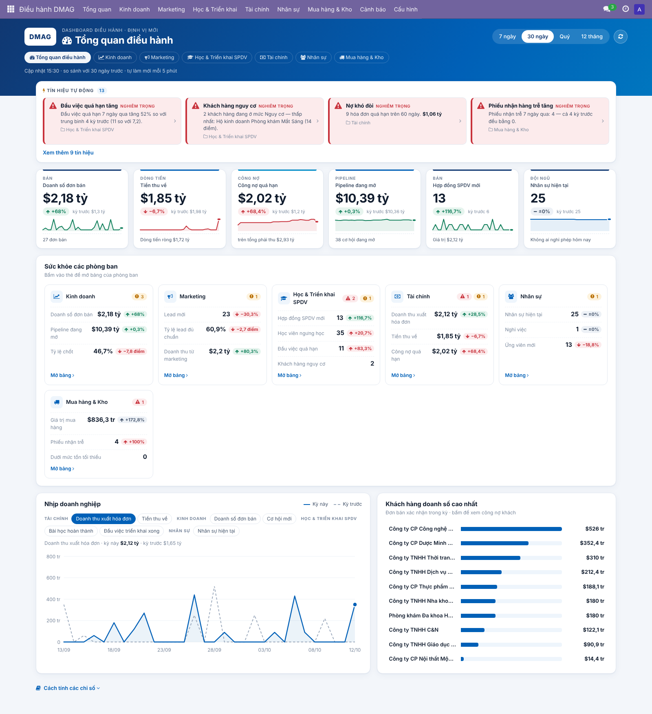
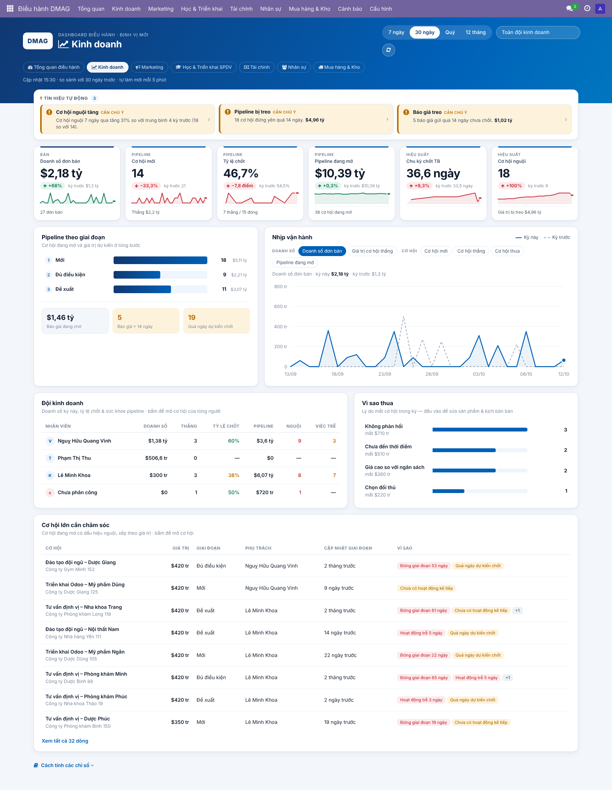
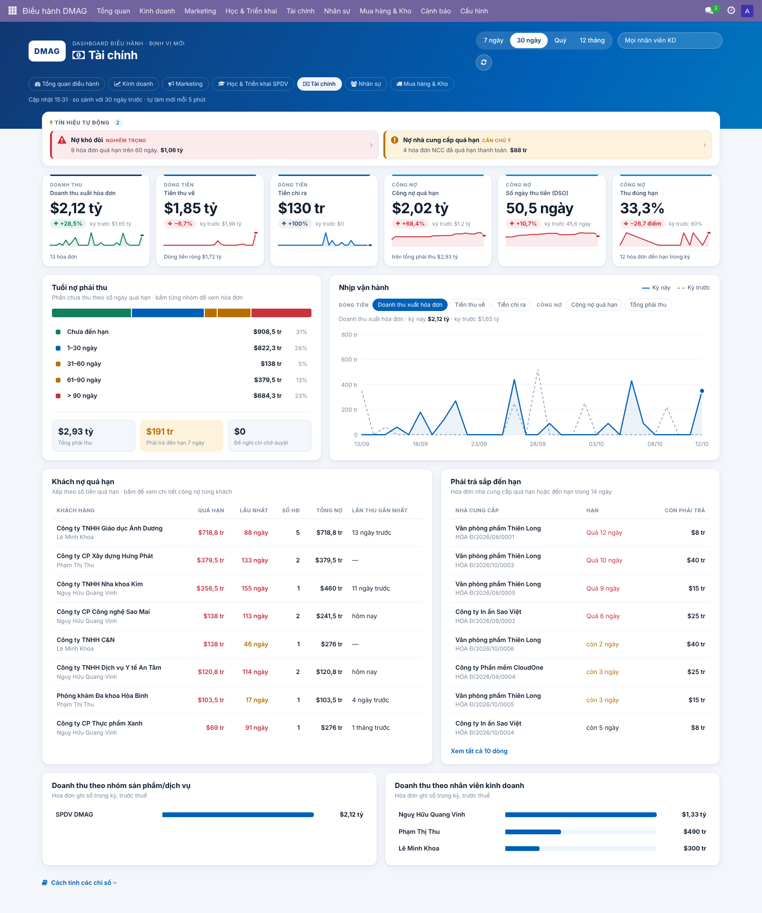
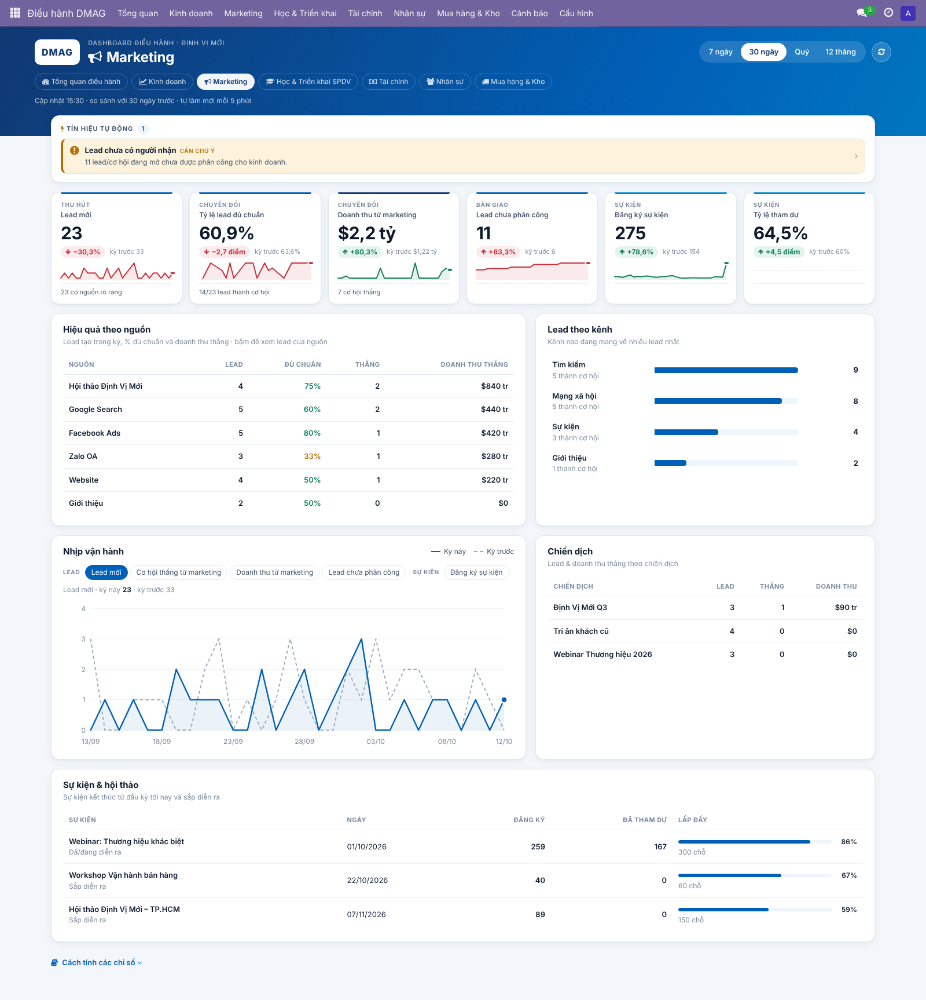
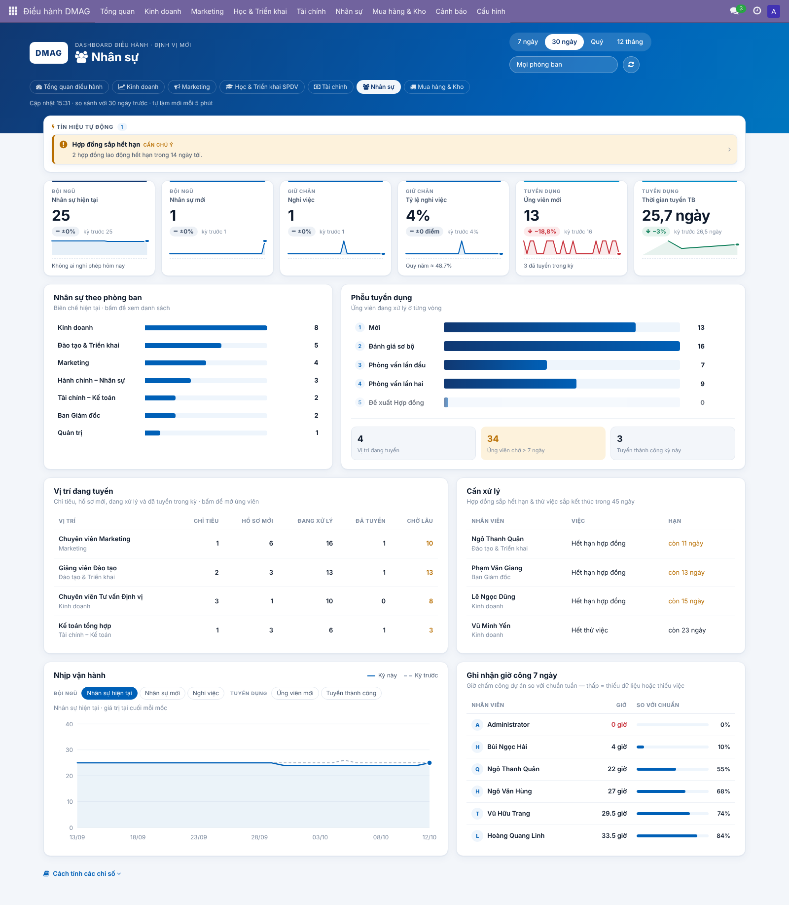
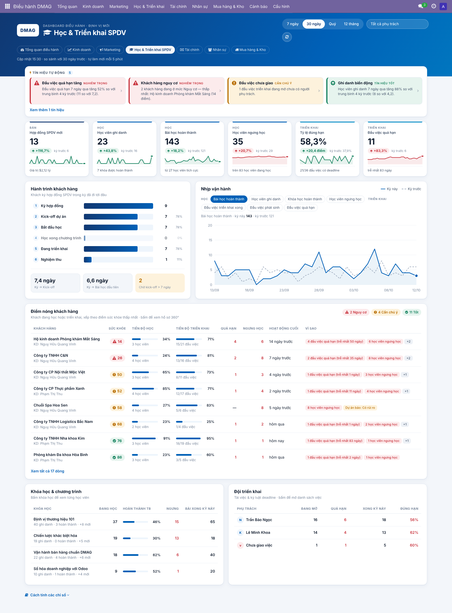
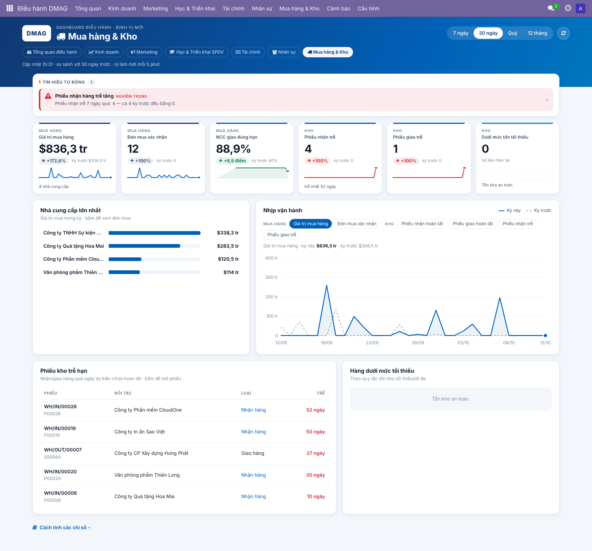
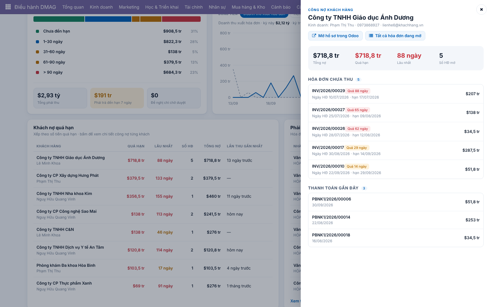
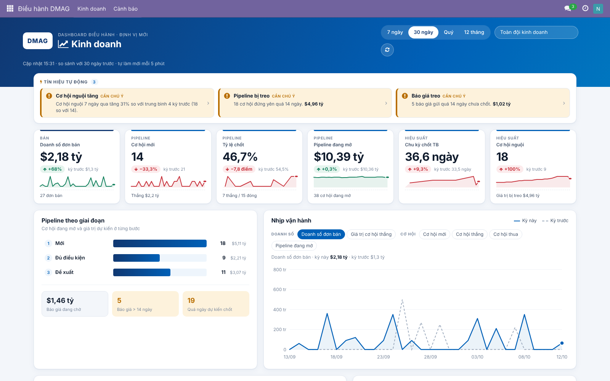

# DMAG · Dashboard Điều hành theo vai trò (Odoo 17 CE)

Module `dmag_dashboard` là một ứng dụng **mới, độc lập**. Nó đọc dữ liệu sẵn có trong Odoo và **không sửa** dashboard của BizApps, nên nâng cấp BizApps không làm hỏng nó.

Module gồm **7 bảng điều khiển**. Mỗi vai trò chỉ thấy bảng của phòng ban mình. Ban điều hành thấy tất cả.



## Các bảng & câu hỏi mỗi bảng trả lời

| Bảng | Vai trò | Chỉ số chính | Điểm nóng / Drill-down |
|---|---|---|---|
| **Tổng quan điều hành** | Ban điều hành | Doanh số, Tiền thu về, Công nợ quá hạn, Pipeline, Hợp đồng SPDV mới, Nhân sự | Thẻ sức khỏe từng phòng ban (bấm để mở bảng), tín hiệu gộp toàn công ty, khách hàng doanh số cao nhất |
| **Kinh doanh** | Trưởng phòng / NV kinh doanh | Doanh số đơn bán, Cơ hội mới, Tỷ lệ chốt, Pipeline đang mở, Chu kỳ chốt TB, Cơ hội nguội | Pipeline theo giai đoạn, báo giá treo, bảng xếp hạng đội KD, lý do thua, cơ hội lớn đang nguội |
| **Marketing** | Marketing | Lead mới, Tỷ lệ lead đủ chuẩn, Doanh thu từ marketing, Lead chưa phân công, Đăng ký sự kiện, Tỷ lệ tham dự | Hiệu quả theo nguồn/kênh/chiến dịch (tới tận doanh thu thắng), sự kiện & hội thảo |
| **Học & Triển khai SPDV** | Đào tạo & Triển khai | Hợp đồng SPDV mới, Ghi danh, Bài học hoàn thành, Học viên ngưng học, Tỷ lệ đúng hạn, Việc quá hạn | Hành trình khách hàng, điểm sức khỏe, hồ sơ 360°, khóa học, đội triển khai |
| **Tài chính** | Kế toán trưởng / CFO | Doanh thu xuất HĐ, Tiền thu, Tiền chi, Công nợ quá hạn, DSO, Tỷ lệ thu đúng hạn | Tuổi nợ phải thu, khách nợ quá hạn (hồ sơ công nợ), phải trả sắp đến hạn, đề nghị chi chờ duyệt, doanh thu theo nhóm SPDV / nhân viên |
| **Nhân sự** | HR | Nhân sự hiện tại, Nhân sự mới, Nghỉ việc, Tỷ lệ nghỉ việc, Ứng viên mới, Thời gian tuyển TB | Biên chế theo phòng ban, phễu tuyển dụng, vị trí đang tuyển, hợp đồng/thử việc sắp hết hạn, ghi nhận giờ công 7 ngày |
| **Mua hàng & Kho** | Vận hành | Giá trị mua, Đơn mua, NCC giao đúng hạn, Phiếu nhận trễ, Phiếu giao trễ, Hàng dưới mức tối thiểu | Nhà cung cấp lớn nhất, phiếu kho trễ hạn, hàng cần đặt thêm |

Mọi bảng đều có các phần sau:
- **Bộ lọc thời gian:** 7 ngày / 30 ngày / Quý / 12 tháng. Mọi chỉ số được **so với kỳ trước** và có sparkline.
- **Biểu đồ nhịp:** đường nét đứt là kỳ trước.
- **Tín hiệu tự động:** báo trồi sụt theo kiểu Google Analytics Insights.
- **Phần "Cách tính các chỉ số":** để mọi người hiểu một nghĩa duy nhất cho từng con số.
- **Drill-down 3 tầng:** chỉ số → danh sách đã lọc đúng con số đó, hoặc hồ sơ 360° → bản ghi gốc. Màn hình gốc vẫn theo phân quyền Odoo của người xem.
- **Tự ẩn khi thiếu ứng dụng nguồn:** bảng nào thiếu ứng dụng (ví dụ chưa cài Mua hàng) sẽ hiện thông báo thay vì lỗi. Một số chỉ số phụ (sự kiện, tuyển dụng, hợp đồng, chấm công) chỉ hiện khi ứng dụng tương ứng đã cài.

## Phân quyền theo vai trò
Vào **Thiết lập → Người dùng → nhóm "DMAG Điều hành"**:
- Các vai trò: Kinh doanh · Marketing · Đào tạo & Triển khai · Tài chính – Kế toán · Nhân sự · Mua hàng & Kho. Mỗi vai trò chỉ mở được bảng của mình; người dùng có thể giữ nhiều vai trò.
- **Ban điều hành:** xem tất cả các bảng và bảng Tổng quan.
- **Quản trị dashboard & cảnh báo:** thêm quyền sửa quy tắc cảnh báo và thiết lập. Admin có sẵn quyền này.

Backend kiểm tra quyền ở mọi lời gọi dữ liệu, không chỉ ẩn menu. Ví dụ: nhân viên Kinh doanh gọi thẳng vào bảng Tài chính sẽ bị từ chối.

## Cảnh báo trồi sụt
- Menu **Cảnh báo → Quy tắc cảnh báo**. Mỗi quy tắc chọn một chỉ số của bất kỳ bảng nào, kèm: cửa sổ thời gian, số kỳ dùng làm nền, chiều biến động, ngưỡng %, ngưỡng độ bất thường z, khối lượng tối thiểu và người nhận.
- Có sẵn 15 quy tắc mẫu, gồm: doanh số tháng giảm, cơ hội mới sụt, cơ hội nguội tăng, lead biến động, tiền thu giảm, công nợ quá hạn tăng, nghỉ việc tăng, phiếu nhận trễ tăng, cùng các quy tắc học & triển khai.
- Cron chạy **mỗi giờ**. Khi một quy tắc kích hoạt, hệ thống đăng tin vào kênh Discuss **"DMAG · Cảnh báo điều hành"**, bật **thông báo tức thời** trên màn hình người nhận và ghi vào **Nhật ký cảnh báo**. Mỗi quy tắc không lặp lại trong thời gian chờ (mặc định 24 giờ).

## Cấu hình (Điều hành DMAG → Cấu hình → Thiết lập)
- **Nhóm sản phẩm SPDV:** dùng cho bảng Học & Triển khai.
- **Phạm vi dự án triển khai:** dự án có khách hàng / dự án gắn đơn bán / tất cả dự án.
- **Ngưỡng ngưng học** và **ngưỡng không hoạt động**.

## Cài đặt
1. Chép `dmag_dashboard/` vào `addons_path` của server Odoo 17.
2. Vào Ứng dụng → Cập nhật danh sách → cài **DMAG · Dashboard Điều hành**.
   - Module phụ thuộc bắt buộc: `sale_project`, `website_slides`, `mail`.
   - Các ứng dụng khác dùng nếu có: `crm`, `account`, `hr`, `hr_recruitment`, `hr_contract`, `hr_timesheet`, `hr_holidays`, `hr_expense`, `event`, `purchase`, `stock`.
3. Gán vai trò cho từng người (xem phần Phân quyền).

Khi cài, module thêm 2 trường có lưu trữ, vì Odoo 17 không lưu sẵn các mốc này. Dữ liệu cũ được điền tự động.
- `project.task.dmag_closed_date`: ngày đóng việc.
- `slide.channel.partner.dmag_completed_date`: ngày học xong khóa.

### Dữ liệu demo (CHỈ trên DB thử)
```bash
./odoo-bin shell -c odoo.conf -d <db_thu> < dmag_dashboard/scripts/seed_demo_data.py
./odoo-bin shell -c odoo.conf -d <db_thu> < dmag_dashboard/scripts/seed_demo_departments.py
```

### Test
```bash
./odoo-bin -c odoo.conf -d <db_test_moi> -i dmag_dashboard,crm,hr_recruitment,hr_contract,purchase_stock,event,hr_timesheet \
  --test-tags /dmag_dashboard --stop-after-init
```

## Đổi màu thương hiệu
Mọi màu nằm ở khối token `.o_dmag { --dmag-… }` đầu file `dmag_dashboard/static/src/dashboard/dashboard.scss`. Màu hiện tại lấy từ giao diện Odoo của DMAG: xanh `#0060B7`, navy `#103872`, cyan `#018CC7`. Màu trạng thái (tốt / chú ý / nguy cơ) chỉ dùng cho trạng thái.

## Kiến trúc: thêm một bảng mới không cần viết JS
- `models/board_base.py`: engine chung. Gồm phạm vi thời gian, so sánh kỳ trước, sparkline, tín hiệu, drill-down và kiểm tra quyền.
- `models/board_<phòng ban>.py`: mỗi bảng là một model `dmag.board.<key>`, khai báo:
  - `_dmag_metrics()`: **danh mục chỉ số**, nguồn sự thật duy nhất cho KPI, biểu đồ, cảnh báo và drill-down;
  - `_load()`: đọc dữ liệu thô **một lần** cho mỗi lượt tải. Mỗi bảng tải dưới 0,35 giây với dữ liệu demo;
  - `_metric()`: cách tính từng chỉ số;
  - `_rows()`: các panel (funnel, trend, table, bars, aging, boards);
  - `_drill()` / `_detail()`: xem chi tiết.
- `static/src/dashboard/`: một client action OWL chung vẽ mọi bảng từ JSON. Biểu đồ vẽ bằng SVG thuần, không phụ thuộc thư viện ngoài.

## Ảnh chụp
| | |
|---|---|
|  |  |
|  |  |
|  |  |
|  |  |
