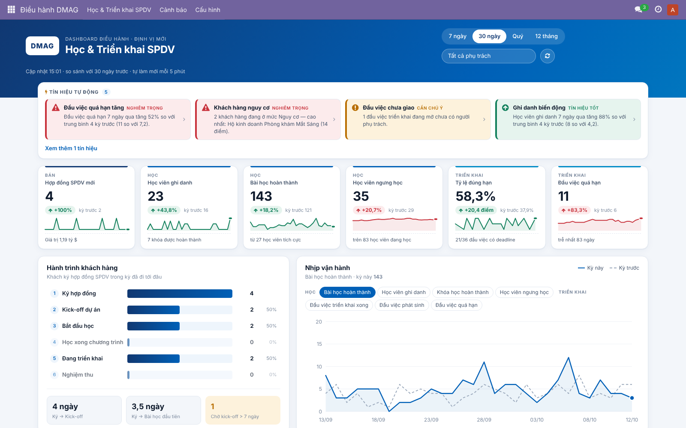
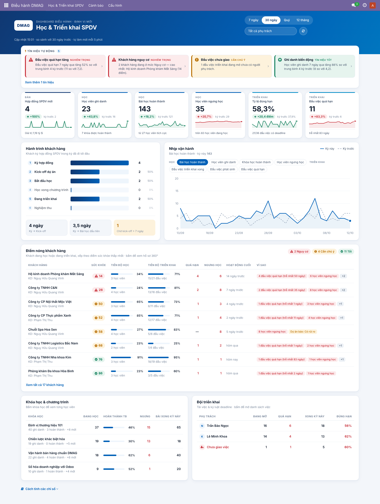
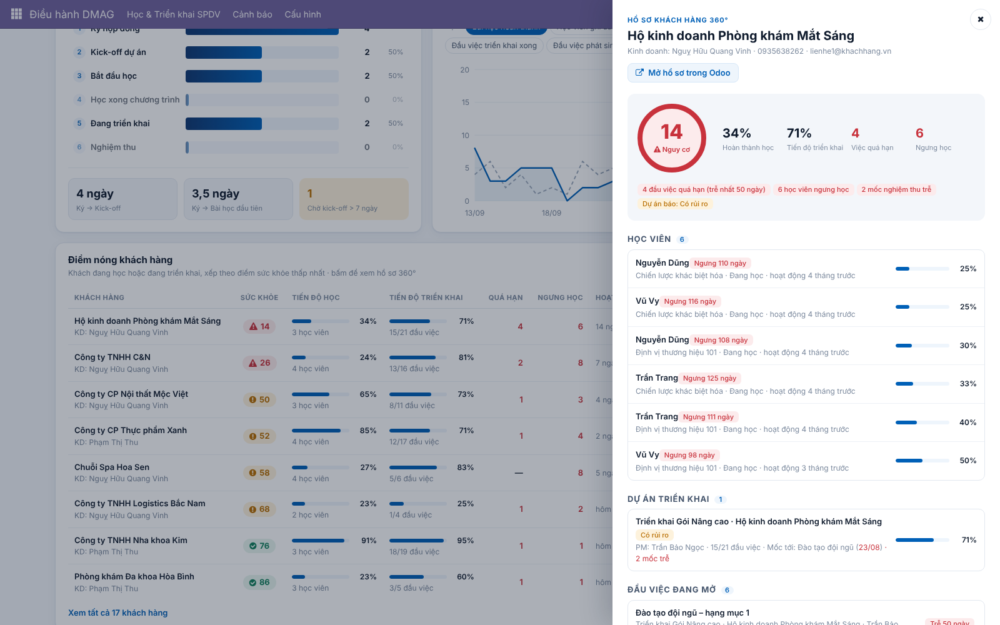
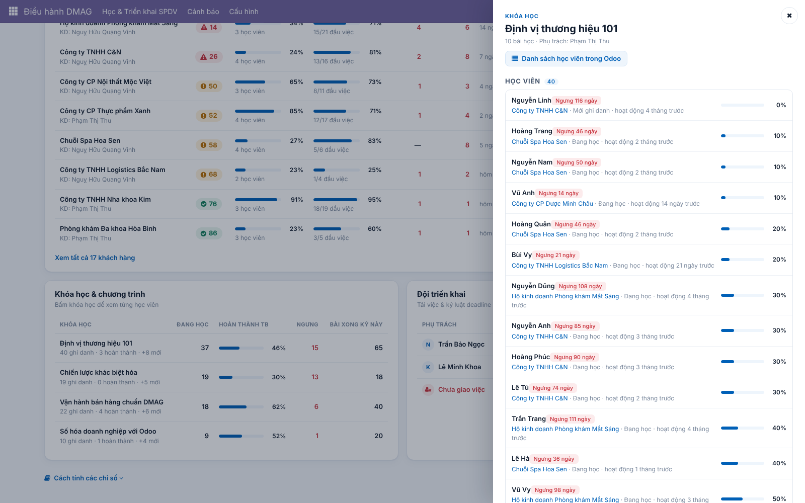
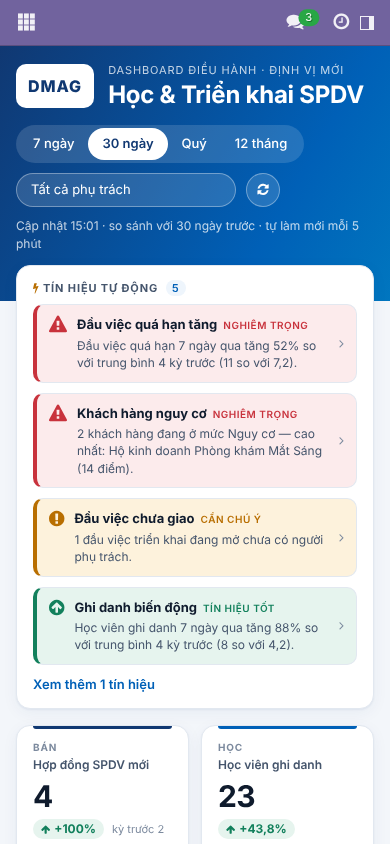

# DMAG · Dashboard Điều hành (Odoo 17 CE)

Module `dmag_dashboard`: một ứng dụng **mới, độc lập**. Nó đọc dữ liệu sẵn có trong Odoo (Bán hàng, Dự án, eLearning) và **không sửa** module dashboard của BizApps, nên nâng cấp BizApps không làm hỏng nó.

Bảng đầu tiên là **Học & Triển khai SPDV**. Bảng này theo dõi hành trình của khách hàng: **Ký hợp đồng → Kick-off → Học → Triển khai → Nghiệm thu**.



## Bảng có gì

| Khu vực | Trả lời câu hỏi | Bấm vào thì đi đâu |
|---|---|---|
| **Tín hiệu tự động** | Có gì trồi sụt bất thường không? (giống Google Analytics Insights) | Danh sách bản ghi gây ra tín hiệu, hoặc hồ sơ khách hàng |
| **6 KPI** (so với kỳ trước + sparkline) | Hợp đồng SPDV mới · Học viên ghi danh · Bài học hoàn thành · Học viên ngưng học · Tỷ lệ đúng hạn · Đầu việc quá hạn | Danh sách gốc trong Odoo, lọc đúng như con số đang xem |
| **Hành trình khách hàng** | Khách ký trong kỳ đã đi tới bước nào, mất bao lâu để kick-off và để học bài đầu tiên, ai đang chờ kick-off | Danh sách khách ở từng bước |
| **Nhịp vận hành** | Xu hướng học và triển khai theo ngày/tuần, so với kỳ trước (đường nét đứt) | Tooltip hiện khi rê chuột |
| **Điểm nóng khách hàng** | Khách nào đang có vấn đề và vì sao (điểm sức khỏe 0–100) | **Hồ sơ 360°**: học viên → dự án → đầu việc → hợp đồng |
| **Khóa học** | Khóa nào có nhiều học viên ngưng học | Từng học viên, tiến độ, ngày hoạt động cuối |
| **Đội triển khai** | Ai đang quá tải hoặc trễ hạn, việc nào chưa giao | Danh sách việc của từng người, nhóm theo dự án |

Drill-down có 3 tầng: **chỉ số → hồ sơ 360° hoặc danh sách → bản ghi gốc** (task, học viên, đơn bán, dự án). Các màn hình gốc vẫn áp dụng phân quyền Odoo của từng người dùng.

### Cảnh báo trồi sụt
- Menu **Điều hành DMAG → Cảnh báo → Quy tắc cảnh báo**. Mỗi quy tắc gồm: chỉ số, cửa sổ thời gian (ví dụ 7 ngày), số kỳ dùng làm nền (ví dụ 4), chiều biến động, ngưỡng %, ngưỡng độ bất thường z và khối lượng tối thiểu (để tránh báo động giả).
- Cron chạy **mỗi giờ**. Khi một quy tắc kích hoạt, hệ thống sẽ:
  - đăng tin vào kênh Discuss **"DMAG · Cảnh báo điều hành"**;
  - bật **thông báo tức thời** trên màn hình người nhận;
  - ghi lại vào **Nhật ký cảnh báo**.

  Mỗi quy tắc không gửi lặp lại trong khoảng thời gian chờ (mặc định 24 giờ).
- Có sẵn 7 quy tắc mẫu: nhịp học giảm, học viên ngưng học tăng, việc quá hạn tăng, tỷ lệ đúng hạn giảm, tốc độ triển khai, ghi danh, hợp đồng SPDV theo tháng.

### Cấu hình (Điều hành DMAG → Cấu hình → Thiết lập)
- **Nhóm sản phẩm SPDV**: đơn bán có sản phẩm thuộc các nhóm này được tính là hợp đồng SPDV. Để trống thì mọi sản phẩm loại Dịch vụ đều được tính.
- **Phạm vi dự án triển khai**: dự án có khách hàng / dự án gắn đơn bán / tất cả dự án.
- **Ngưỡng ngưng học** (mặc định 14 ngày) và **ngưỡng không hoạt động** (mặc định 21 ngày).

Học viên là nhân sự nội bộ (liên hệ thuộc chính công ty mình) không được tính vào số liệu khách hàng.

### Phân quyền
- **DMAG Điều hành / Xem dashboard**: xem bảng và nhật ký cảnh báo.
- **DMAG Điều hành / Quản trị dashboard & cảnh báo**: thêm quyền sửa quy tắc cảnh báo và thiết lập. Admin có sẵn quyền này.

## Cài đặt
1. Chép thư mục `dmag_dashboard/` vào `addons_path` của server Odoo 17.
2. Vào Ứng dụng → Cập nhật danh sách ứng dụng → cài **DMAG · Dashboard Điều hành**.
   Module phụ thuộc: `sale_project`, `website_slides`, `mail`, đều là module chuẩn của CE.
3. Cấp quyền cho ban điều hành (Thiết lập → Người dùng → nhóm *DMAG Điều hành*).

Khi cài, module thêm 2 trường có lưu trữ: `project.task.dmag_closed_date` (Odoo 17 không lưu thời điểm task được đánh dấu xong) và `slide.channel.partner.dmag_completed_date`. Dữ liệu cũ được điền tự động từ ngày đổi giai đoạn hoặc ngày cập nhật cuối.

### Dữ liệu demo (chỉ dùng trên DB thử)
```bash
./odoo-bin shell -c odoo.conf -d <db_thu_nghiem> < dmag_dashboard/scripts/seed_demo_data.py
```

### Test
```bash
./odoo-bin -c odoo.conf -d <db_test_moi> -i dmag_dashboard --test-tags /dmag_dashboard --stop-after-init
```

## Đổi màu thương hiệu
Mọi màu nằm ở đầu file `dmag_dashboard/static/src/dashboard/dashboard.scss`, trong khối token `.o_dmag { --dmag-… }`. Màu hiện tại lấy từ giao diện Odoo của DMAG: xanh `#0060B7`, navy `#103872`, cyan `#018CC7`. Màu trạng thái (tốt / chú ý / nguy cơ) được dành riêng cho trạng thái, không dùng cho chuỗi dữ liệu.

## Kiến trúc (để mở rộng thêm bảng khác)
- `models/dmag_dashboard.py`: **danh mục chỉ số** `METRICS` là nguồn sự thật duy nhất. KPI, sparkline, biểu đồ, cảnh báo và drill-down đều tính từ cùng một hàm `_metric()`. Dữ liệu thô được đọc **một lần** cho mỗi lượt tải, sau đó tính bằng Python. Với dữ liệu demo, một lượt tải mất khoảng 0,05 giây.
- `models/dmag_alert.py`: quy tắc và nhật ký cảnh báo, cron, gửi thông báo qua Discuss và bus.
- `static/src/dashboard/`: client action OWL. Biểu đồ vẽ bằng SVG thuần, không phụ thuộc thư viện ngoài.

Muốn thêm bảng mới (ví dụ *Doanh thu & Dòng tiền*, *Nhân sự*): thêm chỉ số vào `METRICS`, thêm một client action và tái sử dụng các component `Sparkline`, `TrendChart`, `DetailDrawer`.

## Ảnh chụp
| | |
|---|---|
|  |  |
|  |  |
